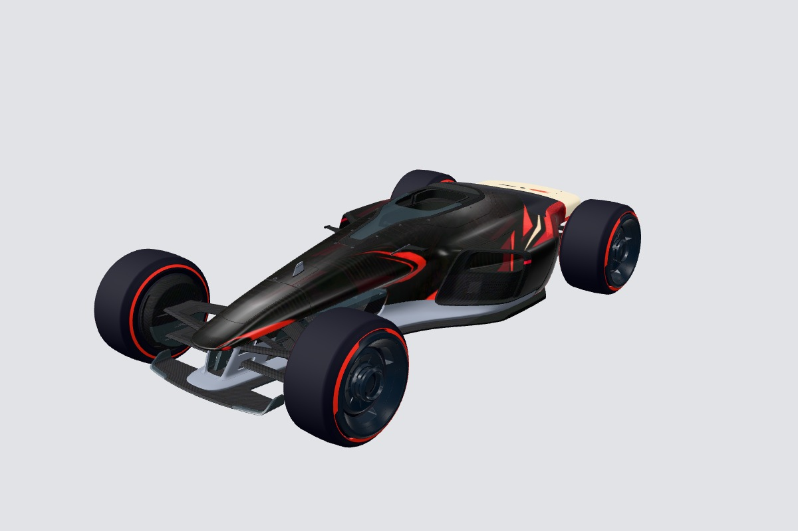

# Trackmania Livery Studio

**Experimental AI-created workflow for real Trackmania 2020 Stadium skins.**

This project was created with AI using ChatGPT Work / Codex, including most of the code, instructions and demo artwork. I made it public simply because I thought it might be useful to someone besides me. It grew out of making and repeatedly fixing my own skin, not out of a professional plugin-development team.

It is a personal experiment, not a promise that any AI will produce a perfect skin in one attempt. The workflow aims to deliver an actual DDS skin ZIP and editable sources, rather than a concept render pretending to be a finished skin.

[Русская инструкция](README.ru.md) · [Download releases](https://github.com/meowflyx/trackmania-livery-studio/releases) · [Validation status](docs/VALIDATION.md)



## What it does

- Researches a requested team/season/race livery before adapting it to Stadium proportions.
- Uses the host's image generator for flat artwork and material assets; places exact text/logos separately.
- Projects artwork onto a bundled, hashed community UV/model profile, with separate moving-wing and number-panel regions.
- Retains layered OpenRaster sources, input artwork and a portable composition recipe.
- Exports legacy DDS files with complete mip chains and audits the real ZIP contents.
- Previews the actual compressed colour mip chain instead of silently generating different mipmaps from a PNG.

The bundled model is **community work, not an official Nadeo template**. The package does not include our earlier Red Bull livery, user screenshots or sponsor artwork. See [third-party notices and provenance](THIRD_PARTY.md).

## Requirements

The tested encoder path is **Windows x64**, Python 3.10+, Pillow and NumPy. A pinned Microsoft texconv executable is bundled with its MIT license. The core instructions are portable, but other operating systems need a compatible native encoder supplied explicitly. Other agents also need file execution and image-viewing tools; image generation and browsing depend on the host. This plugin adds no paid API backend and does not unlock tools your host does not provide.

Automatic screenshots are optional: Node.js, Playwright and an existing compatible browser are needed only for `capture.cjs`. The package never installs a browser or downloads code automatically.

## Install in desktop Work / Codex

With a current Codex CLI:

```text
codex plugin marketplace add meowflyx/trackmania-livery-studio
codex plugin add trackmania-livery-studio@trackmania-livery-studio
codex plugin list --json
```

This registers a **community GitHub marketplace**, not the official OpenAI directory. Refresh/restart the desktop app if the new entry is absent. In a new Work chat type `@`, select **Trackmania Livery Studio** from the menu, then describe the desired skin. Typing its name as plain text is not an installation.

On Windows, a very deep checkout or custom `CODEX_HOME` can exceed Git's path limit. Prefer a short path. If installation reports `Filename too long`, the following enables long paths only for this PowerShell process and its Git child commands, without changing your global Git configuration:

```powershell
$env:GIT_CONFIG_COUNT='1'
$env:GIT_CONFIG_KEY_0='core.longpaths'
$env:GIT_CONFIG_VALUE_0='true'
codex plugin marketplace add meowflyx/trackmania-livery-studio
codex plugin add trackmania-livery-studio@trackmania-livery-studio
```

Use a fresh shell for that example if you already supply `GIT_CONFIG_*` overrides. Close it afterwards to discard the temporary settings. Repository `.gitattributes` preserves exact bytes across checkouts because the asset manifest deliberately verifies file hashes, including text assets.

```text
@Trackmania Livery Studio Create an importable Trackmania 2020 Stadium skin inspired by Ferrari at the 2026 United States Grand Prix in Austin. Verify the exact reference, preserve editable sources and inspect the actual DDS result from all sides.
```

That is a usage example, not a claim that a particular race-specific livery exists or has been tested. The skill should research it and clearly label any interpretation when an exact reference is unavailable.

For offline/local installation, download the marketplace ZIP from Releases, extract it to a persistent directory, then register that extracted directory instead of `owner/repo`. Do not register both copies unless you intentionally want duplicate entries.

The standalone skill archive is for hosts that support Agent Skills. Copy its complete `trackmania-livery-studio` directory, not only `SKILL.md`. A Claude-compatible manifest is included, but Claude runtime execution has not been validated.

## Dependencies and direct use

In a checkout, a dedicated environment avoids changing your existing Python setup:

```powershell
py -m venv .venv
.\.venv\Scripts\python.exe -m pip install -r plugins/trackmania-livery-studio/skills/trackmania-livery-studio/scripts/requirements.txt
.\.venv\Scripts\python.exe plugins/trackmania-livery-studio/skills/trackmania-livery-studio/scripts/studio.py doctor
```

Tell your agent to use that interpreter if its default environment lacks the dependencies. The installed plugin cache may live separately from this checkout.

Run `studio.py --help` for deterministic operations. Read the skill's [pipeline](plugins/trackmania-livery-studio/skills/trackmania-livery-studio/references/pipeline.md) before composing textures. A reproducible original, unbranded example is in [examples/ember](examples/ember); its generator prompt and actual flat artwork are included.

## What has actually been tested

See [VALIDATION.md](docs/VALIDATION.md) and the CI results. File validation, external preview inspection and live-game validation are separate states. Screenshots in this repository are labelled external previews, not Trackmania captures. Existing earlier skins were used during development, but that does not prove this public release's game import, dynamic displays or moving-wing appearance.

The project remains a public alpha until the documented gaps are exercised. Please report the ZIP/map name, complete screenshot, camera distance and reproducible steps when filing an issue. Never attach account tokens or unrelated private files.

## Updating and uninstalling

```text
codex plugin marketplace upgrade trackmania-livery-studio
codex plugin remove trackmania-livery-studio@trackmania-livery-studio
codex plugin marketplace remove trackmania-livery-studio
```

Upgrading a marketplace refreshes its source; inspect the installed plugin version and use your client's install/update flow as needed. Do not assume editing a source folder changes an installed cached copy.

## Licensing and affiliation

Original code/instructions: [MIT](LICENSE). Community model and derived texture resources retain **CC BY 4.0** attribution. Microsoft DirectXTex and Three.js retain their own MIT notices. Generated example artwork is identified as AI-generated; no guarantee of exclusivity is made. [THIRD_PARTY.md](THIRD_PARTY.md) describes the boundaries.

This is an unofficial community project, not affiliated with or endorsed by Nadeo, Ubisoft, OpenAI, Anthropic, Formula 1 or any racing team. It is not published in the official OpenAI directory.
